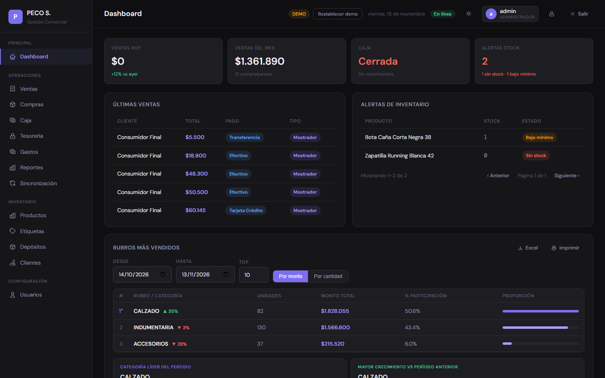
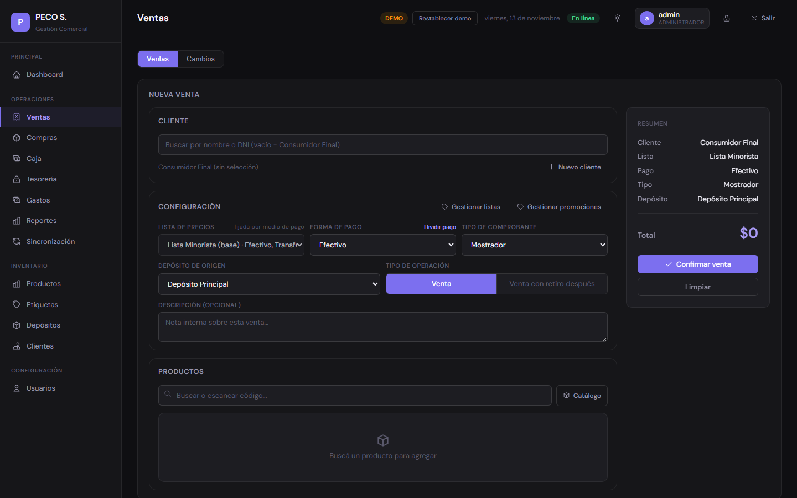
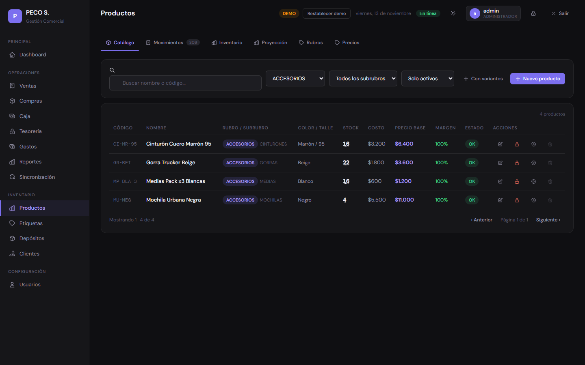
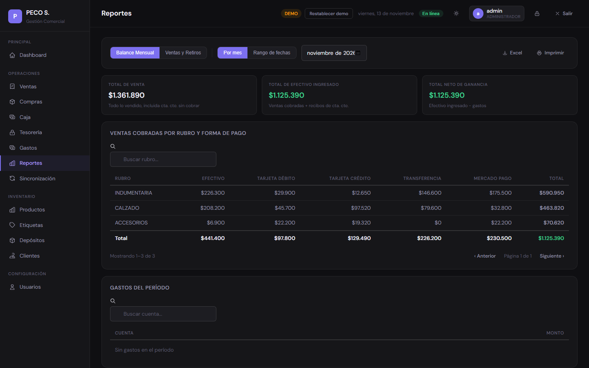
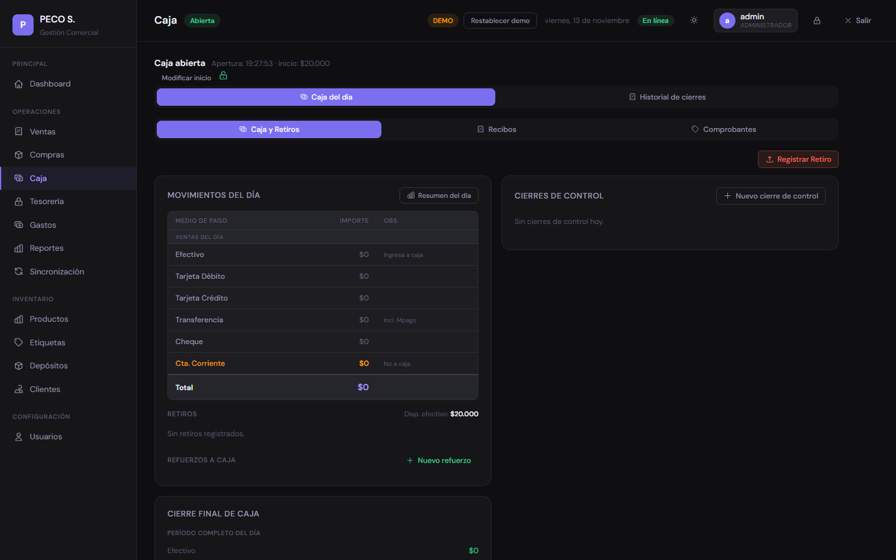

# PECO S. — Sistema de gestión de ventas y logística

Sistema de gestión para comercio minorista (indumentaria y calzado) que cubre
todo el circuito del negocio: ventas en mostrador, stock en varios depósitos,
caja diaria, cuentas corrientes de clientes, compras a proveedores, tesorería y
reportes. Funciona **sin conexión a internet** y sincroniza al volver la red.

Este repositorio es una **versión demo** del sistema real: misma interfaz y
misma lógica de negocio, pero sin servidor. Los datos se guardan en el
navegador de cada visitante.

### 👉 [Probar la demo en vivo](https://abihdp.github.io/Demo-Sistema-de-venta-y-logistica/)

| Usuario    | Contraseña | Rol |
|------------|------------|-----|
| `admin`    | `demo`     | Administrador (todos los permisos) |
| `vendedor` | `demo`     | Vendedor (ventas, productos, clientes, caja) |

> Tip: primero abrí la caja desde **Caja** para poder registrar ventas.
> El botón **Restablecer demo** vuelve a los datos de ejemplo.



## Funcionalidades

**Ventas**
- Punto de venta con búsqueda por nombre o código de barras, varias listas de
  precios y promociones.
- Pago dividido entre varios medios (efectivo, tarjetas, transferencia,
  Mercado Pago) y venta a cuenta corriente.
- Ventas con seña y retiro posterior, reservas de mercadería.
- Cambios de artículos y anulaciones con notas de crédito/débito.

**Inventario y logística**
- Productos con variantes (color/talle), rubros y subrubros.
- Stock por depósito, pases entre depósitos e historial de movimientos.
- Alertas de stock mínimo y proyección de reposición según ventas.
- Impresión de etiquetas con código de barras.

**Finanzas**
- Apertura y cierre de caja con arqueo, retiros y refuerzos.
- Cuentas corrientes de clientes con límite de crédito y recargo por mora.
- Compras a proveedores y órdenes de pago.
- Tesorería: cheques, tarjetas con planes de cuotas e interés, gastos por cuenta.
- Reportes de balance mensual y ventas por rubro, exportables a Excel.

**Usuarios**
- Roles y permisos por pantalla, con PIN para autorizar operaciones sensibles.

## Aspectos técnicos destacados

- **Funcionamiento offline-first.** Las operaciones hechas sin conexión se
  guardan en IndexedDB como una cola (`src/lib/outbox.js`) y se reproducen en
  orden al volver la red. Cada operación lleva un identificador único
  (`client_op_id`) para que un reintento nunca la registre dos veces, y un
  mutex evita que se ejecute en paralelo con su propio reintento.
- **Varias PCs en simultáneo.** Los cambios se propagan en tiempo real entre
  computadoras (Supabase Realtime), con control de concurrencia optimista en
  la caja para que dos puestos no se pisen al abrir, cerrar o retirar.
- **Demo sin backend.** `src/lib/supabase.js` reemplaza al cliente de
  Supabase por una implementación propia que imita su API (`select`, `insert`,
  `upsert`, filtros, `order`, `range`, `rpc`, realtime) sobre `localStorage`.
  El resto de la aplicación es el mismo código que la versión real, sin
  modificaciones.
- **Impresión directa en ticketera** mediante un agente local en .NET
  (no incluido en la demo).

## Tecnologías

React 19 · Vite · Supabase (PostgreSQL, Auth, Realtime) · IndexedDB (`idb`) ·
JsBarcode · SheetJS (exportación a Excel) · GitHub Actions + GitHub Pages

## Capturas

| | |
|---|---|
|  |  |
| **Punto de venta** | **Catálogo de productos** |
|  |  |
| **Reportes** | **Caja del día** |

## Correr en local

```bash
npm install
npm run dev
```

`npm run build` genera en `dist/` un sitio estático que se puede publicar en
cualquier hosting. Cada push a `main` lo publica automáticamente en GitHub
Pages (`.github/workflows/deploy.yml`).

## Estructura

```
src/
├── components/   # Pantallas por módulo (ventas, caja, productos, ...)
├── hooks/        # Lógica de datos por entidad (useVentas, useCaja, ...)
├── lib/          # Cliente de datos, cola offline, conectividad
├── utils/        # Cálculos de negocio, reportes, tesorería
└── constants/
```

Si se modifican los datos de ejemplo (`src/lib/demoSeed.js`), subir
`DEMO_VERSION` para que los navegadores que ya abrieron la demo los recarguen.
